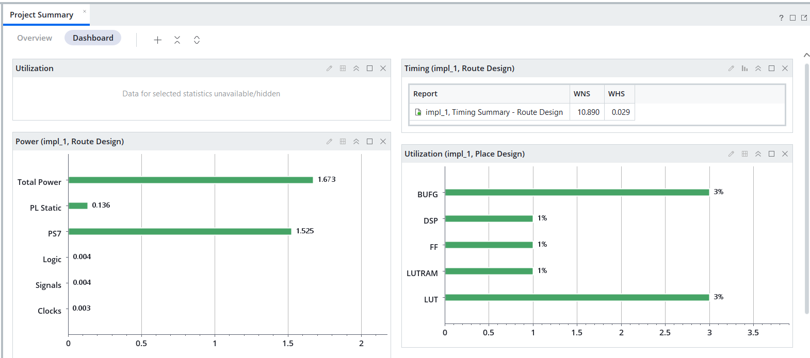
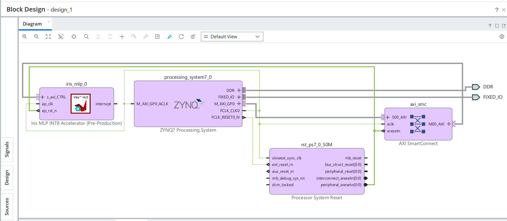
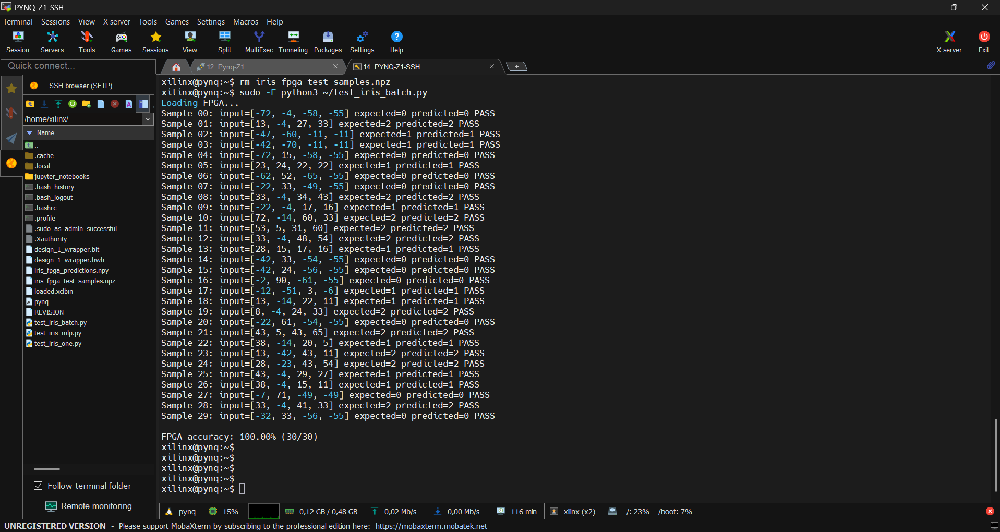

# INT8 Iris MLP FPGA Accelerator

An end-to-end FPGA implementation of a quantized neural network for Iris flower classification using **AMD Vitis HLS, Vivado, and the PYNQ-Z1 development board**.

This project explores neural network quantization, fixed-point arithmetic, FPGA hardware acceleration, AXI4-Lite communication, and on-board inference validation.

<p align="center">
  
</p>

## Table of Contents

- [Project Overview](#project-overview)
- [Neural Network Architecture](#neural-network-architecture)
- [Hardware Architecture](#hardware-architecture)
- [Development Environment](#development-environment)
- [Implementation and Verification](#implementation-and-verification)
- [FPGA Resource Utilization](#fpga-resource-utilization)
- [Repository Structure](#repository-structure)
- [Running the Project](#running-the-project)
- [Future Improvements](#future-improvements)

## Project Overview

The objective is to deploy a compact multilayer perceptron (MLP) on the programmable logic of a Zynq-7000 FPGA and execute inference directly on hardware.

The workflow includes:

1. Training an MLP for Iris flower classification.
2. Standardizing input features using a scaler fitted on the training data.
3. Quantizing the model parameters and inputs for INT8 inference.
4. Implementing the neural network using fixed-point arithmetic in Vitis HLS.
5. Generating a custom accelerator IP and integrating it into a Vivado block design.
6. Generating the FPGA bitstream for the PYNQ-Z1 board.
7. Running Python-based inference tests on the physical board.
8. Comparing the FPGA predictions against the expected labels.

## Neural Network Architecture

The accelerator implements a fully connected neural network with one hidden layer.

| Component | Configuration |
|---|---|
| Input features | 4 |
| Hidden layer | 8 neurons |
| Hidden activation | ReLU |
| Output classes | 3 |
| Input representation | Signed INT8 |
| Weight representation | Signed INT8 |
| Biases and accumulators | INT32 |
| Hardware interface | AXI4-Lite |
| Output | Predicted class ID: 0, 1, or 2 |

The network classifies samples into three Iris species:

- **Class 0:** Iris-setosa
- **Class 1:** Iris-versicolor
- **Class 2:** Iris-virginica

Input features are standardized before quantization. The resulting quantized inputs are transferred to the FPGA accelerator for inference.

## Hardware Architecture

The accelerator is integrated into a Vivado block design containing the Zynq Processing System, AXI interconnect, reset logic, and custom MLP IP.

### Vivado Block Design

<p align="center">
  
</p>

The Processing System communicates with the accelerator through AXI4-Lite control and data registers. The Python test application writes the input features, starts inference, waits for completion, and reads the predicted class.

The hardware implementation includes:

- INT8 multiply-accumulate operations.
- INT32 accumulation.
- Fixed-point requantization.
- ReLU activation.
- INT8 saturation.
- Argmax classification.

## Development Environment

| Component | Configuration |
|---|---|
| FPGA development board | PYNQ-Z1 |
| FPGA device | `xc7z020clg400-1` |
| HLS tool | AMD Vitis HLS 2026.1 |
| Hardware design tool | AMD Vivado 2026.1 |
| Board software | PYNQ 3.1.1 |
| Accelerator interface | AXI4-Lite |
| HLS clock target | 10 ns |

## Implementation and Verification

### 1. HLS Verification

The HLS design passed the following verification stages:

- C simulation.
- C/RTL co-simulation.

The reported co-simulation latency is **32 clock cycles**, corresponding to approximately **320 ns at the 10 ns HLS clock target**.

This value represents the reported HLS simulation latency, not the complete Python-to-FPGA execution time.

### HLS Reports

The following reports summarize the HLS synthesis and co-simulation results.

<p align="center">
  
</p>

Detailed reports are available in the [`reports/`](reports/) directory:

- [`hls_csynth.rpt`](reports/hls_csynth.rpt)
- [`iris_mlp_csynth.rpt`](reports/iris_mlp_csynth.rpt)
- [`iris_mlp_cosim.rpt`](reports/iris_mlp_cosim.rpt)
- [`hls_latency.rpt`](reports/hls_latency.rpt)

### 2. FPGA Hardware Validation

The generated bitstream was loaded onto the physical PYNQ-Z1 board. A Python test script executed inference on **30 held-out test samples**.

**Measured accuracy: 100% (30/30 samples).**

All 30 FPGA predictions matched their expected class labels for this test set.

<p align="center">
  
</p>

This result applies to the tested subset and does not guarantee 100% accuracy on all unseen samples.

### 3. Vivado Timing and Resource Results

The current Vivado implementation reports the following resource utilization and timing results.

## FPGA Resource Utilization

| Resource or metric | Reported value |
|---|---:|
| LUTs | 1,334 |
| Flip-flops | 1,211 |
| BRAM | 0 |
| DSP | 1 |
| Worst Negative Slack (WNS) | +10.888 ns |

These values correspond to the current implementation and its timing constraints. The positive WNS indicates that the reported design meets its specified setup timing requirement.

## Repository Structure

The following is a simplified overview of the main project files.

```text
FPGA-Acclerator-project/
├── README.md
├── .gitignore
├── basic-MLP/
│   ├── Iris.csv
│   ├── iris_mlp_params.h
│   ├── iris_mlp_fixed_metadata.json
│   ├── iris_mlp_int8_metadata.json
│   └── iris_fpga_test_samples.npz
├── hls-2026-iris/
│   ├── hls_2026-iris/
│   │   ├── iris_mlp.cpp
│   │   ├── iris_mlp_tb.cpp
│   │   └── hls_config.cfg
│   └── iris_mlp_acclerator/
│       └── iris_mlp_acclerator.xpr
├── pynq/
│   ├── design_1_wrapper.bit
│   └── design_1_wrapper.hwh
├── reports/
│   ├── hls_csynth.rpt
│   ├── iris_mlp_csynth.rpt
│   ├── iris_mlp_cosim.rpt
│   └── hls_latency.rpt
└── docs/
    └── images/
        ├── BlockDesign-iris.png
        ├── MobaXtream-fpga-iris-results.png
        └── ProjectSummary.png
```

This tree highlights the main source files, hardware design, reports, deployment artifacts, and documentation. Generated Vivado and Vitis HLS build directories are omitted.

**Note:** The `.bit` file is excluded by the current `.gitignore`. If it is not committed to GitHub, the `pynq/` folder in the online repository will not contain the bitstream until you publish it separately, for example through a GitHub Release.

## Running the Project

The general workflow is:

1. Prepare the Iris dataset and train or load the MLP model.
2. Generate the quantized model parameters.
3. Run C simulation and C/RTL co-simulation in Vitis HLS.
4. Synthesize the HLS design and export the accelerator IP.
5. Integrate the IP into the Vivado block design and generate the bitstream.
6. Copy the matching `.bit` and `.hwh` files to the PYNQ-Z1.
7. Run the Python inference test application on the board.

The Python test application must use the same input preprocessing and quantization parameters as the model used to generate the FPGA accelerator.

## Future Improvements

- Evaluate INT4 and binary quantization to reduce hardware resource usage.
- Compare latency, resource utilization, and classification accuracy across numeric formats.
- Extend the accelerator to larger neural networks and other datasets.
- Explore pipelining, parallelism, and alternative memory architectures.
- Investigate hardware-software co-design and more advanced FPGA AI acceleration techniques.

---

*This project is a hands-on exploration of quantized neural networks, high-level synthesis, and hardware acceleration on an FPGA platform.*